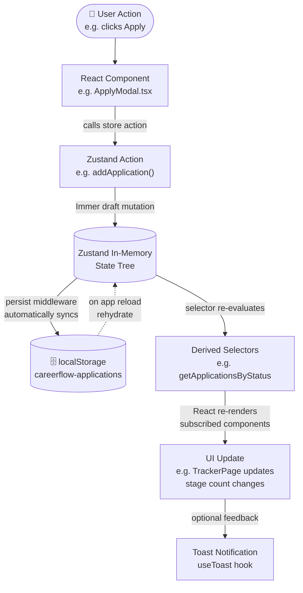
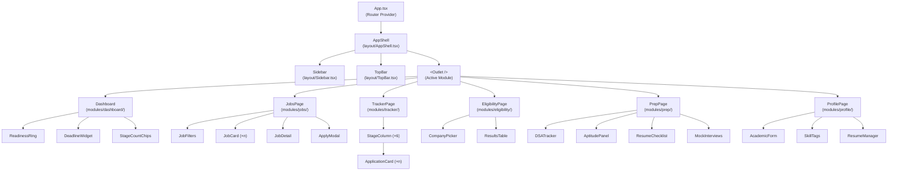

# CareerFlow — Architecture Document

> **Version:** 1.0.0 · **Last updated:** 2026-11-03  
> **Scope:** System design, data flow, component hierarchy, build pipeline, and design decisions for the CareerFlow campus placement portal.

---

## Table of Contents

1. [System Overview](#1-system-overview)
2. [Project Structure](#2-project-structure)
3. [Data Flow Diagram](#3-data-flow-diagram)
4. [Store Architecture](#4-store-architecture)
5. [Eligibility Engine](#5-eligibility-engine)
6. [Routing](#6-routing)
7. [localStorage Schema](#7-localstorage-schema)
8. [Component Hierarchy](#8-component-hierarchy)
9. [Build Pipeline](#9-build-pipeline)
10. [Design Decisions & Trade-offs](#10-design-decisions--trade-offs)

---

## 1. System Overview

CareerFlow is a **fully client-side Single Page Application (SPA)**. There is no backend server, no REST API, no GraphQL endpoint, and no network requests at runtime (beyond CDN-served static assets on initial load). Every byte of application state lives in the user's browser.

### Key architectural properties

| Property | Detail |
|---|---|
| **Rendering model** | Client-side rendering (CSR) via React 18 |
| **Data persistence** | `localStorage` via Zustand `persist` middleware |
| **Network calls at runtime** | None — all data is mock/static |
| **Authentication** | None — single-user app (student) |
| **State management** | Zustand 4 with Immer middleware |
| **Type safety** | TypeScript 5 strict mode throughout |
| **Styling** | Tailwind CSS 3, no custom CSS except complex animations |
| **Build tool** | Vite 5 |
| **Router** | React Router v6 |

### Runtime environment

```
Browser
  └── CareerFlow SPA (React 18 + TypeScript)
        ├── React Router v6    (client-side navigation)
        ├── Zustand Store      (in-memory state + immer mutations)
        │     └── persist middleware → localStorage
        └── Mock Data Layer    (src/data/ — static TS files)
```

All application logic — eligibility checking, progress calculations, readiness scores — runs as pure TypeScript functions in the browser. There is no server-side computation.

---

## 2. Project Structure

```
CareerFlow/
│
├── docs/                          ← All project documentation
│   ├── architecture/
│   │   └── Architecture.md        ← This document
│   ├── schema/
│   │   └── Schema.md              ← Data schema & TypeScript types
│   └── rules/
│       └── Rules.md               ← Coding conventions & agent rules
│
├── public/                        ← Static assets served at root
│   └── favicon.svg
│
├── src/                           ← All application source code
│   │
│   ├── main.tsx                   ← App entry point; mounts <App /> to #root
│   ├── App.tsx                    ← Router setup + store provider wrapper
│   ├── index.css                  ← Tailwind directives (@tailwind base/components/utilities)
│   │
│   ├── types/
│   │   └── index.ts               ← All shared TypeScript interfaces & enums
│   │                                 (Student, Resume, Job, Application, PrepProgress, …)
│   │
│   ├── data/                      ← Static mock data (never fetched at runtime)
│   │   ├── jobs.ts                ← Array of 10 mock Job objects
│   │   └── student.ts             ← Default Student profile (Aarav Mehta)
│   │
│   ├── store/                     ← Zustand store slices
│   │   ├── index.ts               ← Combines slices; exports useStore hook
│   │   ├── studentSlice.ts        ← Student profile state + actions
│   │   ├── jobsSlice.ts           ← Jobs list, saved jobs, filters state + actions
│   │   ├── applicationsSlice.ts   ← Application records state + actions
│   │   └── prepSlice.ts           ← Preparation progress state + actions
│   │
│   ├── lib/                       ← Pure utility functions (no React, no store)
│   │   └── eligibility.ts         ← checkEligibility(student, job) → EligibilityResult
│   │
│   ├── hooks/                     ← Custom React hooks
│   │   ├── useEligibility.ts      ← Wraps checkEligibility with store data; memoized
│   │   └── useToast.ts            ← Toast queue hook (push/dismiss)
│   │
│   ├── components/                ← Reusable, module-agnostic components
│   │   │
│   │   ├── layout/                ← Top-level layout primitives
│   │   │   ├── Sidebar.tsx        ← Left nav with module links + active highlight
│   │   │   ├── TopBar.tsx         ← Header with student name, breadcrumb, notifications
│   │   │   └── AppShell.tsx       ← Composes Sidebar + TopBar + <Outlet />
│   │   │
│   │   └── ui/                    ← Design-system primitives
│   │       ├── Button.tsx         ← Variants: primary, secondary, ghost, danger
│   │       ├── Badge.tsx          ← Status/label badges with color variants
│   │       ├── Card.tsx           ← Surface container with optional header/footer
│   │       ├── Modal.tsx          ← Accessible modal with focus trap + ESC close
│   │       ├── Toast.tsx          ← Toast notification (success/error/info)
│   │       ├── ProgressBar.tsx    ← Linear progress with label + percentage
│   │       ├── Stepper.tsx        ← Horizontal step indicator for application stages
│   │       └── EligibilityPill.tsx← Green ✓ / Red ✗ pill for eligibility status
│   │
│   └── modules/                   ← Feature modules (one per portal section)
│       │
│       ├── dashboard/
│       │   ├── Dashboard.tsx      ← Module root; layout of all dashboard widgets
│       │   ├── ReadinessRing.tsx  ← SVG donut chart for placement readiness score
│       │   ├── DeadlineWidget.tsx ← Upcoming deadlines sorted by date proximity
│       │   └── StageCountChips.tsx← Count chips per application stage
│       │
│       ├── jobs/
│       │   ├── JobsPage.tsx       ← Module root; job list + filter sidebar
│       │   ├── JobCard.tsx        ← Single job card with eligibility pill + save button
│       │   ├── JobFilters.tsx     ← Filter controls (type, CTC range, branch, CGPA)
│       │   ├── ApplyModal.tsx     ← Resume picker + confirm apply modal
│       │   └── JobDetail.tsx      ← Full job detail panel / drawer
│       │
│       ├── tracker/
│       │   ├── TrackerPage.tsx    ← Module root; Kanban-style stage columns
│       │   ├── StageColumn.tsx    ← Single Kanban column (Applied/Shortlisted/…)
│       │   └── ApplicationCard.tsx← Card showing company, role, next step nudge
│       │
│       ├── eligibility/
│       │   ├── EligibilityPage.tsx← Module root; company picker + results
│       │   ├── CompanyPicker.tsx  ← Multi-select or single company selector
│       │   └── ResultsTable.tsx   ← Pass/fail criteria table per company
│       │
│       ├── prep/
│       │   ├── PrepPage.tsx       ← Module root; tab layout of prep sections
│       │   ├── DSATracker.tsx     ← DSA topic progress bars (solved / total)
│       │   ├── AptitudePanel.tsx  ← Mock aptitude score history + attempt logger
│       │   ├── ResumeChecklist.tsx← Checklist items for resume completeness
│       │   └── MockInterviews.tsx ← Book / view mock interview slots
│       │
│       └── profile/
│           ├── ProfilePage.tsx    ← Module root; tabbed profile editor
│           ├── AcademicForm.tsx   ← CGPA, branch, year, 10th/12th, backlogs form
│           ├── SkillTags.tsx      ← Add/remove skill tags with autocomplete
│           └── ResumeManager.tsx  ← Upload, preview, set primary resume
```

---

## 3. Data Flow Diagram

The following diagram illustrates the complete data flow from a user action through the store to the UI.



### Flow description

1. **User Action** — Button click, form submit, toggle, etc.
2. **Component** — Calls a Zustand action from `useStore()`.
3. **Zustand Action** — Mutates Immer draft state; action is a pure function with no side effects.
4. **In-Memory State** — Updated synchronously; all subscribers notified.
5. **Persist Middleware** — Serializes updated state slice to `localStorage` automatically.
6. **Selectors** — Derived values (e.g., filtered job lists) re-compute via memoized selectors.
7. **UI Re-render** — Only components subscribed to changed state slices re-render.
8. **Toast** — Async confirmations (apply success, save job, etc.) surface via `useToast`.
9. **Rehydration** — On next page load, `persist` reads `localStorage` and restores state before first render.

---

## 4. Store Architecture

All state is managed in a single Zustand store composed of four slices. Each slice owns a distinct domain, has its own `localStorage` persistence key, and exposes typed actions.

### 4.1 `studentSlice`

| Item | Detail |
|---|---|
| **Persistence key** | `careerflow-student` |
| **State shape** | `{ student: Student }` |
| **Initial state** | Imported from `src/data/student.ts` (Aarav Mehta defaults) |

**Actions:**

```ts
updateProfile(patch: Partial<Student>): void
addSkill(skill: string): void
removeSkill(skill: string): void
addResume(resume: Resume): void
removeResume(id: string): void
setPrimaryResume(id: string): void
updatePreferences(prefs: Partial<Student['preferences']>): void
```

**Selectors:**

```ts
selectStudent(): Student
selectPrimaryResume(): Resume | undefined
selectProfileCompleteness(): number  // 0–100
```

---

### 4.2 `jobsSlice`

| Item | Detail |
|---|---|
| **Persistence key** | `careerflow-jobs` |
| **State shape** | `{ jobs: Job[]; filters: JobFilters; searchQuery: string }` |
| **Initial state** | Jobs imported from `src/data/jobs.ts`; all `isSaved: false` |

**Actions:**

```ts
toggleSaveJob(jobId: string): void
setFilters(filters: Partial<JobFilters>): void
setSearchQuery(query: string): void
resetFilters(): void
```

**Selectors:**

```ts
selectAllJobs(): Job[]
selectSavedJobs(): Job[]
selectFilteredJobs(): Job[]   // applies active filters + search
selectJobById(id: string): Job | undefined
```

---

### 4.3 `applicationsSlice`

| Item | Detail |
|---|---|
| **Persistence key** | `careerflow-applications` |
| **State shape** | `{ applications: Application[] }` |
| **Initial state** | `[]` (empty array) |

**Actions:**

```ts
addApplication(payload: Omit<Application, 'id' | 'appliedAt'>): void
updateStatus(id: string, status: Application['status']): void
updateNextStep(id: string, nextStep: string): void
withdrawApplication(id: string): void
```

**Selectors:**

```ts
selectAllApplications(): Application[]
selectApplicationsByStatus(status: Application['status']): Application[]
selectApplicationByJobId(jobId: string): Application | undefined
selectApplicationsWithDeadlines(): Application[]  // sorted by deadline proximity
```

---

### 4.4 `prepSlice`

| Item | Detail |
|---|---|
| **Persistence key** | `careerflow-prep` |
| **State shape** | `{ progress: PrepProgress }` |
| **Initial state** | Empty DSA topics, empty aptitude history, all checklist items false |

**Actions:**

```ts
updateDSATopic(topic: string, solved: number, total: number): void
logAptitudeScore(score: number): void
toggleChecklistItem(item: string): void
bookMockInterview(slot: string): void
completeMockInterview(slot: string): void
```

**Selectors:**

```ts
selectDSAProgress(): { topic: string; solved: number; total: number; percent: number }[]
selectAptitudeHistory(): AptitudeAttempt[]
selectChecklistCompletion(): number  // 0–100
selectReadinessScore(): number       // composite 0–100
```

---

## 5. Eligibility Engine

The eligibility engine is a **pure function** in `src/lib/eligibility.ts`. It has zero side effects, no store access, and no React dependency — it can be unit tested in isolation.

### Function signature

```ts
function checkEligibility(
  student: Student,
  job: Job
): EligibilityResult
```

### Algorithm (step-by-step)

1. **Branch check** — Is `student.branch` in `job.eligibility.branches`? If the array is empty, all branches pass.
2. **CGPA check** — Is `student.cgpa >= job.eligibility.minCGPA`?
3. **Backlogs check** — Is `student.backlogs <= job.eligibility.maxBacklogs`?
4. **10th percent check** — Is `student.tenthPercent >= job.eligibility.minTenthPercent`?
5. **12th percent check** — Is `student.twelfthPercent >= job.eligibility.minTwelfthPercent`?
6. **Skills check** — Does `student.skills` (case-insensitive) contain **all** of `job.eligibility.requiredSkills`? If `requiredSkills` is empty, this check passes automatically.
7. **Aggregate result** — `isEligible = true` only if every criterion passes.
8. **Return** — `EligibilityResult` with `isEligible`, `pass[]`, and `fail[]` arrays, each entry containing `criterion`, `studentValue`, and `required`.

### Output shape

```ts
interface EligibilityResult {
  isEligible: boolean
  pass: CriterionDetail[]
  fail: CriterionDetail[]
}

interface CriterionDetail {
  criterion: string    // e.g. "CGPA", "Branch", "Active Backlogs"
  studentValue: string // e.g. "8.4", "CS", "0"
  required: string     // e.g. "≥ 8.5", "CS / IT", "≤ 0"
}
```

### Edge cases

| Case | Behaviour |
|---|---|
| `requiredSkills = []` | Skills criterion not emitted; always passes |
| `branches = []` | Branch criterion not emitted; all branches pass |
| `minTenthPercent = 0` | 10th criterion not emitted |
| `minTwelfthPercent = 0` | 12th criterion not emitted |
| `student.cgpa = 0` | Fails all CGPA-gated companies |
| Duplicate skills (case variants) | Normalised to lowercase before comparison |

---

## 6. Routing

React Router v6 is used with `createBrowserRouter`. All routes are nested under the `AppShell` layout route.

| Path | Component | Description |
|---|---|---|
| `/` | `redirect → /dashboard` | Root redirect |
| `/dashboard` | `Dashboard` | Placement readiness overview |
| `/jobs` | `JobsPage` | Browse & filter job listings |
| `/jobs/:jobId` | `JobDetail` | Full job detail view |
| `/tracker` | `TrackerPage` | Kanban application stage board |
| `/eligibility` | `EligibilityPage` | Check eligibility for any company |
| `/prep` | `PrepPage` | DSA, aptitude, checklist, mock interviews |
| `/profile` | `ProfilePage` | Edit academic profile, skills, resumes |
| `*` | `NotFound` (inline) | 404 fallback |

All routes are **lazy-loaded** using `React.lazy()` + `<Suspense>` to keep initial bundle lean.

---

## 7. localStorage Schema

Zustand `persist` middleware serialises each slice independently.

| Key | Type | Description | Default |
|---|---|---|---|
| `careerflow-student` | `{ state: { student: Student }, version: number }` | Student profile including resumes and preferences | Aarav Mehta defaults |
| `careerflow-jobs` | `{ state: { jobs: Job[], filters: JobFilters, searchQuery: string }, version: number }` | All job listings with saved flags and active filters | 10 mock jobs, no filters |
| `careerflow-applications` | `{ state: { applications: Application[] }, version: number }` | All submitted applications | `[]` |
| `careerflow-prep` | `{ state: { progress: PrepProgress }, version: number }` | DSA, aptitude, checklist, mock interview records | All zeroed |

Each entry is wrapped in Zustand's standard `{ state, version }` envelope to support future migrations via the `migrate` option.

---

## 8. Component Hierarchy



---

## 9. Build Pipeline

### Vite 5 configuration highlights

```ts
// vite.config.ts
export default defineConfig({
  plugins: [react()],
  resolve: {
    alias: { '@': path.resolve(__dirname, './src') }
  },
  build: {
    target: 'es2020',
    sourcemap: true,
    rollupOptions: {
      output: {
        manualChunks: {
          vendor: ['react', 'react-dom', 'react-router-dom'],
          store:  ['zustand', 'immer'],
        }
      }
    }
  }
})
```

### TypeScript 5 configuration highlights

```jsonc
// tsconfig.json
{
  "compilerOptions": {
    "strict": true,
    "target": "ES2020",
    "lib": ["ES2020", "DOM", "DOM.Iterable"],
    "module": "ESNext",
    "moduleResolution": "bundler",
    "jsx": "react-jsx",
    "baseUrl": ".",
    "paths": { "@/*": ["./src/*"] },
    "noUnusedLocals": true,
    "noUnusedParameters": true,
    "noFallthroughCasesInSwitch": true
  }
}
```

### Tailwind CSS 3 configuration highlights

```ts
// tailwind.config.ts
export default {
  content: ['./index.html', './src/**/*.{ts,tsx}'],
  theme: {
    extend: {
      colors: {
        brand: { DEFAULT: '#4F46E5', light: '#818CF8', dark: '#3730A3' },
        success: '#22C55E',
        warning: '#F59E0B',
        danger: '#EF4444',
      },
      fontFamily: { sans: ['Inter', 'sans-serif'] },
    }
  },
  plugins: []
}
```

### Scripts

| Script | Command | Purpose |
|---|---|---|
| `dev` | `vite` | Dev server with HMR on `localhost:5173` |
| `build` | `vite build` | Production bundle to `dist/` |
| `preview` | `vite preview` | Serve `dist/` locally |
| `typecheck` | `tsc --noEmit` | Type-check without emitting files |
| `test` | `vitest` | Unit test runner |
| `lint` | `eslint src --ext ts,tsx` | Linting |

---

## 10. Design Decisions & Trade-offs

### No backend

**Decision:** All state is client-only; no API server.

**Rationale:** CareerFlow is a campus portal prototype / demo. Adding a backend (Node, Go, etc.) would introduce auth, deployment infra, CORS, and environment config that are unnecessary for a single-student demo app. All data fits comfortably in `localStorage` (< 1 MB). If a backend is added later, the Zustand actions can be wired to async `fetch` calls with minimal component changes.

**Trade-off:** Data doesn't persist across browsers or devices; a cleared browser wipes all progress.

---

### Zustand over Redux

**Decision:** Zustand 4 with Immer middleware instead of Redux Toolkit.

**Rationale:** Zustand requires ~3× less boilerplate than RTK for equivalent functionality. The store needs no providers, no `connect()`, no `createSlice` ceremony. Immer gives safe mutable-style mutations. For a ~6-module app with straightforward state, Zustand is the right size.

**Trade-off:** Redux DevTools integration is slightly more manual; time-travel debugging is less polished. Acceptable given app scale.

---

### Vite over CRA (Create React App)

**Decision:** Vite 5 as the build tool.

**Rationale:** CRA is deprecated. Vite provides near-instant dev server startup via native ESM, faster HMR, and a modern Rollup-based production build with better tree-shaking. TypeScript support is first-class. `vite-plugin-react` with SWC gives sub-second fast refresh.

**Trade-off:** Slightly more configuration required upfront vs. CRA's zero-config approach.

---

### Tailwind CSS over CSS Modules

**Decision:** Tailwind CSS 3 utility classes; no CSS Modules or styled-components.

**Rationale:** Utility-first CSS keeps styles co-located with markup, eliminating the context-switch of separate `.module.css` files. Tailwind's JIT compiler produces minimal CSS (< 10 KB in production). Design tokens (colors, spacing, fonts) are centralised in `tailwind.config.ts`. The project has a strong design constraint: no hardcoded hex values in components.

**Trade-off:** Class strings can become long on complex components. Mitigated by extracting repeated patterns into UI primitives (`Button`, `Card`, etc.) and using `cn()` / `clsx` for conditional class composition.

---

*End of Architecture Document*
