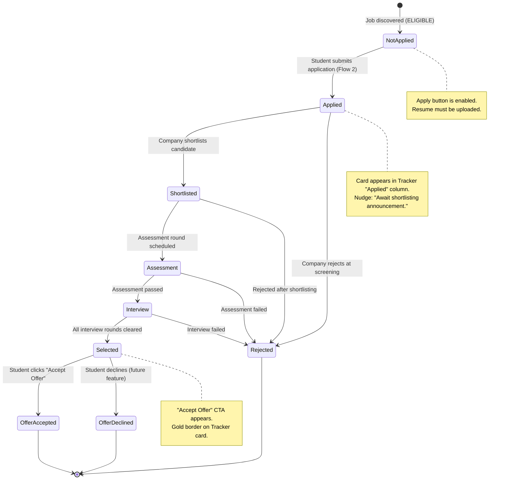
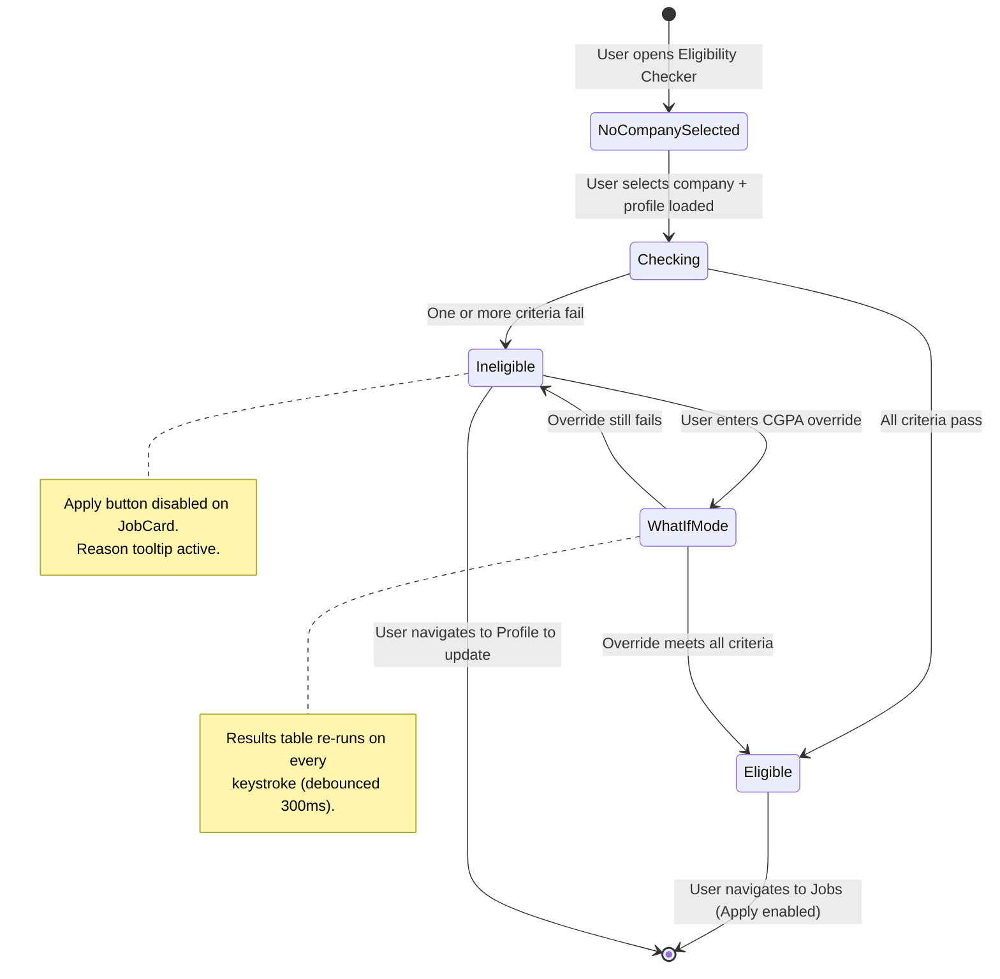
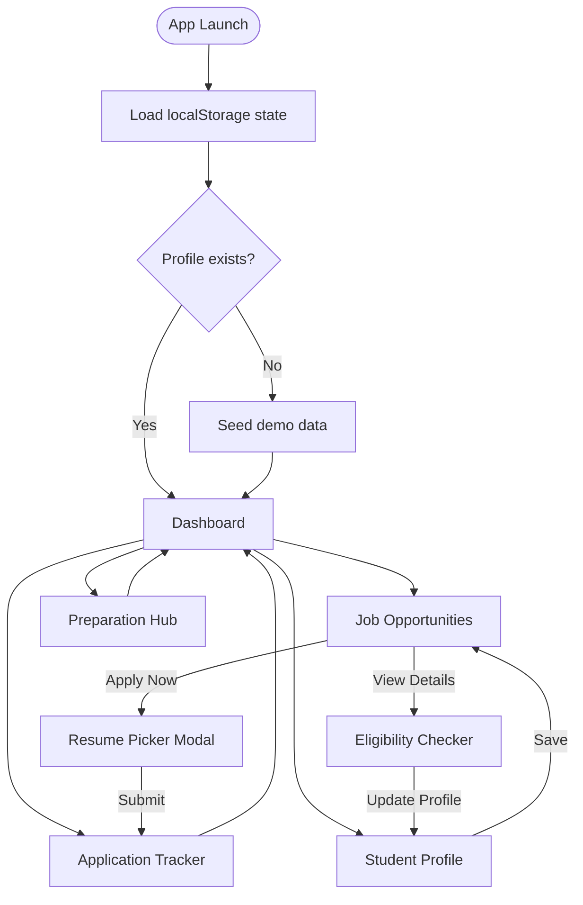

# CareerFlow — App Flow

> **Version:** 1.0 · **Audience:** Product, Engineering, QA · **Status:** Canonical Reference

---

## Table of Contents

1. [Overview](#1-overview)
2. [Flow 1: Discover & Browse Jobs](#2-flow-1-discover--browse-jobs)
3. [Flow 2: Apply for a Job](#3-flow-2-apply-for-a-job)
4. [Flow 3: Eligibility Recovery](#4-flow-3-eligibility-recovery)
5. [Flow 4: Preparation](#5-flow-4-preparation)
6. [Flow 5: Track Application](#6-flow-5-track-application)
7. [Cross-Module Navigation Map](#7-cross-module-navigation-map)
8. [State Transitions Diagram](#8-state-transitions-diagram)
9. [Error & Edge Cases](#9-error--edge-cases)
10. [Demo Mode Description](#10-demo-mode-description)

---

## 1. Overview

CareerFlow is a **single-page React application** with no backend — all state lives in localStorage/React context and mock data is seeded on first load. The app supports five core user flows that map to Hierarchical Task Analysis (HTA) goals:

| HTA Goal | CareerFlow Flow | Primary Module |
|----------|----------------|----------------|
| Find a suitable job | Flow 1: Discover & Browse | Dashboard → Jobs |
| Submit an application | Flow 2: Apply for a Job | Jobs → Tracker |
| Recover from ineligibility | Flow 3: Eligibility Recovery | Jobs → Checker → Profile → Jobs |
| Improve placement readiness | Flow 4: Preparation | Dashboard → Prep Hub |
| Monitor application progress | Flow 5: Track Application | Tracker |
| Publish placement drive | Flow 6: TPO Drive Creation | Admin → Drive Manager |
| Review applicants & shortlist | Flow 7: Applicant Review & Bulk Shortlist | Admin → Applicant Review |

All flows share the **Sidebar** (desktop) or **Bottom Nav** (mobile) as the persistent navigation spine, with the **TopBar** featuring the **Role Switcher** (Student ↔ TPO Admin) and global search.

---

## 2. Flow 1: Discover & Browse Jobs

**Goal:** Student finds a list of open job opportunities, understands eligibility, and identifies jobs to apply to.

**Persona most served:** Aarav (speed) and Meera (careful comparison)

### Step-by-Step

```
Step 1  → Open App
Step 2  → Land on Dashboard
Step 3  → Optionally click a chip / recommended job card
Step 4  → Navigate to Job Opportunities
Step 5  → Search / filter / sort
Step 6  → Read JobCard, interpret eligibility badge
Step 7  → Decision: eligible → Flow 2 (Apply) | ineligible → Flow 3 (Recovery)
```

### Detailed Steps

**Step 1 — Open App**
- User opens CareerFlow in browser (or returns from background tab)
- App loads; localStorage is checked for saved profile + application state
- If first load: demo seed data is initialised (10 companies, sample applications, profile with CGPA 7.8)
- Router defaults to `/dashboard`

**Step 2 — Land on Dashboard**
- **Readiness Score Ring** renders (initial mount: arc animates from 0 to current score over 600 ms)
- **Deadlines Widget** shows up to 5 companies with approaching deadlines, colour-coded
- **Stage Count Chips** show counts: Applied(3) | Shortlisted(1) | Assessment(1) | Interview(0) | Selected(0)
- **Recommended Jobs Strip** shows 4–6 job mini-cards matching user's branch

**Step 3 — Optional shortcut from Dashboard**
- Aarav clicks a **Recommended Job mini-card** → navigates to `/jobs` with that job's card highlighted (scrolled into view, card border flashes `#2563EB` for 400 ms)
- Meera clicks the "Applied" Stage Chip → navigates to `/tracker?stage=Applied`

**Step 4 — Navigate to Job Opportunities**
- User clicks "Job Opportunities" in the **Sidebar** (or second icon in the **Bottom Nav** on mobile)
- Active sidebar item gains `border-left: 4px solid #2563EB` + `background: #1E3A6E`
- Page title in **TopBar** changes to "Job Opportunities"
- Job card grid renders with default sort: Deadline ascending

**Step 5 — Search / Filter / Sort**

*Search:*
- User clicks into the **Search input** (top of filter sidebar) or presses `/` to focus the **TopBar** global search
- Types "Google" — card grid live-filters (debounced 300 ms) to show only Google listings
- Search is cleared by pressing `Escape` or clicking ✕ in the input

*Filter:*
- Meera opens the **Branch** checkbox group, selects "ECE"
- Selects **Role Type** = "Full-time"
- Drags **Min CGPA slider** to 7.0 (her current CGPA)
- Clicks **"Apply Filters"** primary button
- Results count updates: "Showing 12 of 58 jobs"
- A "Filters active (3)" badge appears on the filter sidebar header on mobile

*Sort:*
- Aarav clicks **"CTC"** in the sort segmented control above the card grid
- Cards re-order with highest CTC first (transition: cards fade out, re-render, fade in over 150 ms)

**Step 6 — Read JobCard, Interpret Eligibility Badge**
- Each card shows: company logo, role title, CTC badge, deadline, CGPA requirement, **StatusPill**
- **ELIGIBLE pill** (teal `#0D9488`): Apply Now button is enabled (primary blue)
- **INELIGIBLE pill** (red `#EF4444`): Apply Now button is disabled, `opacity-50`
- User hovers disabled Apply button → **Tooltip** appears: "You are ineligible: CGPA below 8.0. [View Details →]"
- Meera sees one INELIGIBLE card for a company requiring CGPA ≥ 8.0 → proceeds to Flow 3

**Step 7 — Decision**
- Eligible → clicks "Apply Now" → **Flow 2**
- Ineligible → reads tooltip / clicks "View Details" → **Flow 3**

---

## 3. Flow 2: Apply for a Job

**Goal:** Student submits an application for a job they are eligible for.

**Persona most served:** Aarav (speed), Rohit (careful, needs confirmation)

### Step-by-Step

```
Step 1  → Click "Apply Now" on eligible JobCard
Step 2  → Resume Picker Modal opens
Step 3  → Select resume (primary pre-selected)
Step 4  → Click "Continue"
Step 5  → Confirmation dialog (step 2 within modal)
Step 6  → Tick confirmation checkbox
Step 7  → Click "Submit Application"
Step 8  → Loading state (500 ms)
Step 9  → Modal closes → Success Toast
Step 10 → Tracker gains new "Applied" card
```

### Detailed Steps

**Step 1 — Click "Apply Now"**
- Button: primary blue, 40 px height, full-width within card
- Only rendered enabled when `student.isEligible(job) === true`
- If no resumes uploaded: button is disabled, tooltip says "Upload a resume in Profile first. [Go to Profile →]"

**Step 2 — Resume Picker Modal Opens**
- Modal animates open: 200 ms ease-out (opacity 0→1, scale 0.95→1)
- `role="dialog"`, `aria-modal="true"`, `aria-labelledby="modal-title"`
- Title: "Apply to **[Role Title]** at **[Company Name]**"
- Close button (✕) top-right, 24 px, ghost variant
- Focus moves to close button on open
- Body: list of uploaded resumes as **radio cards**:
  - Each card: PDF icon + filename + file size + upload date
  - Primary resume: pre-selected radio + `border-left: 3px solid #0D9488` + "Primary" chip
  - Remaining resumes: unselected radio, white border
- "Upload new resume" ghost link at bottom of list → expands inline dropzone within modal (accepts `.pdf`, max 5 MB)

**Step 3 — Select Resume**
- User clicks a resume radio card → it gains selected border `#2563EB`
- Aarav has only one resume (primary); it is already selected — he skips to Step 4
- Rohit has 3 resumes — picks the most recent

**Step 4 — Click "Continue"**
- Button: "Continue" primary, bottom-right of modal body
- Disabled if no resume selected
- Clicking transitions modal body content to confirmation view (150 ms cross-fade)

**Step 5 — Confirmation Dialog**
- Modal title changes to "Confirm Application"
- Summary card (read-only, `#F8FAFC` bg):
  - Company logo + name
  - Role title
  - Resume: "📄 [filename.pdf]" with "Change" ghost link (goes back to Step 3)
- Checkbox below summary: `[ ] I confirm this application is accurate and complete`
  - `aria-required="true"`, `id="confirm-checkbox"`
- "Submit Application" button: **disabled** (`aria-disabled="true"`, `opacity-50`) until checkbox ticked
- "Cancel" ghost button left-aligned (closes modal, no state change)
- Focus on open: moves to checkbox

**Step 6 — Tick Checkbox**
- Checkbox fills with teal checkmark (100 ms animation)
- "Submit Application" button becomes enabled (primary blue, full opacity, cursor-pointer)
- If user somehow triggers submit without ticking (e.g. keyboard Enter on focused button before it's enabled):
  - **Error path:** Checkbox border turns red (`#EF4444`)
  - Inline error text appears below checkbox: "Please confirm before submitting" (12 px, red)
  - `aria-live="assertive"` announces: "Error: Please tick the confirmation checkbox before submitting."
  - Modal stays open

**Step 7 — Click "Submit Application"**
- Button becomes loading state: spinner (16 px white) + label "Submitting…", disabled during load

**Step 8 — Loading State (500 ms simulated)**
- Prevents double-submit (button disabled)
- No network call — state update to localStorage + React context

**Step 9 — Modal Closes → Success Toast**
- Modal closes: 150 ms fade-out
- **Success Toast** slides in from bottom-right: "✓ Applied to **[Role]** at **[Company]**!"
- `role="alert"`, `aria-live="assertive"`
- Auto-dismisses after 4 000 ms; user can click ✕ to dismiss early
- JobCard's "Apply Now" button is replaced with "Applied ✓" chip (teal pill, disabled)

**Step 10 — Tracker Updated**
- Application Tracker (`/tracker`) now shows a new card in the **Applied** column
- Card: company logo + role + deadline + next-step nudge: "Await shortlisting decision"
- Dashboard Stage Count chip "Applied" increments by 1

---

## 4. Flow 3: Eligibility Recovery

**Goal:** Student discovers they are ineligible, investigates criteria, simulates a CGPA target, updates profile if possible, and retries application.

**Persona most served:** Rohit (anxious, needs clear explanations), Meera (data-driven)

### Step-by-Step

```
Step 1  → See INELIGIBLE pill on JobCard (Apply disabled)
Step 2  → Hover / focus disabled Apply button → read tooltip reason
Step 3  → Click "View Details →" in tooltip
Step 4  → Eligibility Checker opens, company pre-filled
Step 5  → Read criterion table (which rows failed)
Step 6  → Enter what-if CGPA in override input
Step 7  → Observe updated eligibility result
Step 8  → If closable gap: navigate to Profile → update CGPA
Step 9  → Return to Jobs → ELIGIBLE pill now shows → Apply (Flow 2)
Step 10 → If gap is too large: accept ineligibility, browse other jobs
```

### Detailed Steps

**Step 1 — INELIGIBLE pill on JobCard**
- **StatusPill** shows `INELIGIBLE` (red `#EF4444` text, `#FEE2E2` bg)
- "Apply Now" button: `opacity-50`, `cursor-not-allowed`, `aria-disabled="true"`

**Step 2 — Tooltip on hover/focus**
- Tooltip appears within 200 ms (no delay on keyboard focus, 300 ms delay on hover to reduce noise)
- Content: "You are ineligible: CGPA below 8.0 threshold. [View Details →]"
- Tooltip bg: `#0F172A`, text white, `border-radius: 6px`, `padding: 8px 12px`
- `role="tooltip"`, `id="tooltip-[jobId]"` linked via `aria-describedby` on Apply button

**Step 3 — Click "View Details"**
- Link in tooltip navigates to `/eligibility?company=[companySlug]`
- Sidebar "Eligibility Checker" nav item becomes active

**Step 4 — Eligibility Checker opens, company pre-filled**
- **Company dropdown** shows the company pre-selected
- **Your Profile summary card** shows current values (CGPA 7.2, Branch CS, etc.)
- Results panel immediately shows criterion table (no need to click "Check Eligibility")

**Step 5 — Read criterion table**
- Each row: Criterion | Required | Your Value | Status (✅ / ❌ / ⚠)
- Failed rows: subtle red-tinted row bg (`#FEF2F2`)
- Passed rows: subtle teal-tinted row bg (`#F0FDF4`)
- **Overall verdict:** Large INELIGIBLE pill + "You need a CGPA of 8.0 (0.8 more than your current 7.2) to qualify."
- Rohit reads: only CGPA is failing — all other criteria pass

**Step 6 — Enter what-if CGPA override**
- **What-if CGPA input** (numeric, 0.01 step): Rohit types "8.0"
- Debounced 300 ms → results table re-renders
- CGPA row flips to ✅ (green), overall pill changes to **ELIGIBLE**
- Guidance text: "With a CGPA of 8.0, you would be eligible for [Company]!"

**Step 7 — Observe updated result**
- Rohit sees the ELIGIBLE verdict — this is a realistic target (he is in 3rd year, can improve)
- He decides to update his current profile CGPA to his latest transcript value (perhaps he mis-entered it)

**Step 8 — Navigate to Profile → Update CGPA**
- Rohit clicks **"Update Profile"** ghost link (below results panel) → navigates to `/profile`
- Alternatively, clicks "Profile" in the Sidebar (or bottom nav)
- In **Section 1 — Personal/Academic**, CGPA field shows 7.2
- Rohit corrects to 7.8 (his actual latest CGPA) and clicks **"Save Changes"**
- **Success Toast:** "Profile updated successfully"
- React context updates: `student.cgpa = 7.8`; eligibility is re-computed for all jobs

**Step 9 — Return to Jobs → Re-evaluate**
- Rohit clicks "Job Opportunities" in Sidebar
- The previously INELIGIBLE card re-evaluates: 7.8 < 8.0 → still INELIGIBLE for that company
- But other cards may have flipped to ELIGIBLE (those requiring ≤ 7.8)
- If CGPA now meets the threshold → pill flips to ELIGIBLE → "Apply Now" enabled → Flow 2

**Step 10 — Gap too large**
- If even updating the profile doesn't bridge the gap (e.g., company requires 9.0 CGPA):
- Guidance: "This company requires a CGPA of 9.0. Focus on other opportunities."
- Rohit returns to Jobs, filters CGPA ≤ 7.8 → sees available opportunities

---

## 5. Flow 4: Preparation

**Goal:** Student uses Preparation Hub to systematically improve their readiness score.

**Persona most served:** Aarav (tracks DSA progress), Rohit (checklist-driven, needs structure)

### Step-by-Step

```
Step 1  → Dashboard: read readiness score (e.g., 54 / 100)
Step 2  → Identify weak areas from score breakdown
Step 3  → Navigate to Prep Hub
Step 4  → DSA tab: log solved problems for a topic
Step 5  → Aptitude tab: check score history, launch quiz
Step 6  → Resume Checklist tab: tick completed items
Step 7  → Return to Dashboard: readiness score has updated
```

### Detailed Steps

**Step 1 — Dashboard: Read Readiness Score**
- Score ring displays 54 / 100 (amber arc)
- Below the ring: a small breakdown hint (tooltip on ring or expandable): "DSA: 60% · Aptitude: 40% · Checklist: 50%"

**Step 2 — Identify Weak Areas**
- User taps/clicks the score ring → opens a mini-breakdown panel (or navigates to Prep Hub directly)
- Weakest area: Aptitude (40%)
- Alternatively, Dashboard may show a "Tip: Complete 3 more checklist items to reach 60!" nudge card

**Step 3 — Navigate to Prep Hub**
- Clicks "Preparation Hub" in Sidebar (book/lightning icon)
- Page renders with last-active tab remembered (defaults to DSA on first visit)
- Tab bar: **DSA** | **Aptitude** | **Resume Checklist** | **Mock Interviews**

**Step 4 — DSA Tab: Log Solved Problems**
- Topic grid renders: Arrays, Linked Lists, Trees, Graphs, DP, Sorting, Searching, Strings, Recursion, Greedy
- Each topic card shows: topic name + "12 / 30 problems" + ProgressBar (success teal)
- Aarav clicks **"Arrays"** topic card → **Problem List Modal** opens
  - Modal lists: problem name (14 px) + difficulty chip (Easy=teal, Medium=amber, Hard=red) + "Solved" checkbox
  - Aarav ticks 3 problems → counter updates to "15 / 30"
  - Modal closes → Arrays card ProgressBar animates to new fill (300 ms ease-out)
- Overall DSA readiness sub-score updates in context (readiness score will update on Dashboard)

**Step 5 — Aptitude Tab: Score History + Quiz**
- **Score history bar chart** shows last 5 quiz scores: [62, 70, 68, 75, 80] — improving trend
- "Start Practice Quiz" primary button (center of page if no history, top-right if history exists)
- Clicking opens **Quiz Modal**:
  - 10 MCQ questions, one at a time, 30-second timer per question (countdown progress bar)
  - "Next" button advances; "Submit" on last question
  - Results screen: score out of 10 + percentage + "Try Again" / "View Details" buttons
  - Score saved to history → bar chart updates → aptitude sub-score updates
- Rohit scores 8/10 → aptitude sub-score jumps significantly

**Step 6 — Resume Checklist Tab: Tick Items**
- Progress summary: "7 / 12 complete" + ProgressBar (warning amber at 58%)
- Rohit ticks 3 more items:
  - "Add quantified achievements to work experience" ✅
  - "Include LinkedIn profile URL" ✅
  - "List relevant coursework or projects" ✅
- Each tick: checkbox fills with teal ✓ (100 ms), ProgressBar width updates (300 ms), summary counter increments
- At 10 / 12: ProgressBar turns success teal (threshold for "good")

**Step 7 — Return to Dashboard: Score Updated**
- Rohit clicks "Dashboard" in Sidebar
- Readiness score ring animates from 54 → 68 (previous score to new score, 600 ms ease-out arc)
- New breakdown: "DSA: 65% · Aptitude: 75% · Checklist: 83%"
- A congratulatory micro-copy appears below the ring: "Great progress! You've improved by +14 points today."

---

## 6. Flow 5: Track Application

**Goal:** Student monitors the status of submitted applications through the placement pipeline.

**Persona most served:** All three personas

### Step-by-Step

```
Step 1  → Navigate to Application Tracker
Step 2  → Read current stage of each application
Step 3  → Read next-step nudge for actionable guidance
Step 4  → (Demo) Click "Advance Stage" button
Step 5  → Card animates to next column
Step 6  → Reach "Selected" (Offer) stage
Step 7  → Click "Accept Offer" → confetti / success state
```

### Detailed Steps

**Step 1 — Navigate to Application Tracker**
- Click "Application Tracker" in Sidebar (or third icon in Bottom Nav)
- Page renders horizontal scroll container with 5 stage columns: **Applied | Shortlisted | Assessment | Interview | Selected**
- **Pipeline Stepper** at top shows stages with connected line

**Step 2 — Read Current Stage**
- Applied column: 3 cards (Google-SWE, Microsoft-SDE, Amazon-SDE)
- Shortlisted column: 1 card (Infosys-SSE)
- Assessment column: 1 card (TCS-Digital)
- Interview column: 0 cards
- Selected column: 0 cards
- Column header shows count badge (e.g., "Applied 3" — blue circle with white "3")

**Step 3 — Read Next-Step Nudge**

Each card contains an **amber info box** with contextual guidance:

| Stage | Nudge Example |
|-------|--------------|
| Applied | "Await shortlisting announcement. Keep an eye on your email." |
| Shortlisted | "Complete HackerRank assessment by Nov 10, 2026." |
| Assessment | "Review your test performance. Interview call expected in 3–5 days." |
| Interview | "Prepare STAR-format behavioral answers. Technical round expected." |
| Selected | "Offer letter sent! Review and accept before [deadline]." |

**Step 4 — Click "Advance Stage" (Demo)**
- Each card has a **"→ Advance Stage"** ghost button (small, 14 px) at the bottom
- This is a demo mechanism — in a real app, stage updates would be pushed by a backend
- Clicking: button shows brief loading spinner (100 ms)

**Step 5 — Card Animates to Next Column**
- Card slides out of current column (translateX + opacity, 300 ms ease-in-out)
- Card appears in next column (translateX + opacity, 300 ms ease-out)
- Column count badges update (-1 current, +1 next)
- **Info Toast (polite):** "Application moved to Shortlisted stage."
- Screen reader: "Application for [Role] at [Company] moved to Shortlisted stage."
- Next-step nudge on the card updates to reflect new stage

**Step 6 — Reach "Selected" (Offer) Stage**
- User advances TCS-Digital application through all stages
- Card enters **Selected** column
- Card appearance changes:
  - Green left border: `border-left: 4px solid #0D9488`
  - "SELECTED" StatusPill (teal)
  - Next-step nudge: "🎉 Congratulations! Review and accept your offer below."
  - "Accept Offer" primary button (green variant: bg `#0D9488`, hover `#0F766E`)

**Step 7 — Click "Accept Offer" → Success State**
- Clicking "Accept Offer": confirmation micro-dialog (inline, not full modal):
  - "Accept offer from [Company]? This action cannot be undone."
  - "Yes, Accept" (teal primary) | "Not yet" (ghost)
- User confirms → **Confetti animation** (2 000 ms particle burst from button, full-screen overlay at 20% opacity)
- Card transforms into a "Selected & Accepted" card:
  - Gold border `#F59E0B`
  - "🏆 Offer Accepted" heading
  - Company name + role
  - "Well done, [Name]!" subtext
- **Success Toast:** "🎉 Congratulations! You've accepted the offer from [Company]!"
- Dashboard readiness score ring shows "Placed!" overlay (optional, if desired for demo)

---

## 7. Cross-Module Navigation Map

```
Dashboard ──────────────────────────────────────────────────────┐
  │                                                              │
  ├── Stage Chip click ──────────────────────► Application Tracker (filtered)
  │
  ├── Recommended Job card click ────────────► Job Opportunities (job highlighted)
  │
  ├── Score Ring click ──────────────────────► Preparation Hub
  │
  └── "Complete profile" banner link ────────► Student Profile

Job Opportunities ──────────────────────────────────────────────┐
  │                                                              │
  ├── Apply Now (eligible) ──────────────────► Resume Picker Modal → Tracker (Applied)
  │
  ├── "View Details" tooltip link ───────────► Eligibility Checker (company pre-filled)
  │
  └── Save icon toggle ──────────────────────► (state change only, no nav)

Application Tracker ────────────────────────────────────────────┐
  │
  └── (no outbound links — read-only view; Advance Stage changes in-page state)

Eligibility Checker ────────────────────────────────────────────┐
  │
  ├── "Update Profile" link ─────────────────► Student Profile
  │
  └── (Back to Jobs: user uses Sidebar nav)

Preparation Hub ────────────────────────────────────────────────┐
  │
  └── (self-contained; readiness score update propagates to Dashboard via context)

Student Profile ────────────────────────────────────────────────┐
  │
  └── (self-contained; CGPA update propagates to eligibility context for Jobs module)
```

### Trigger Summary Table

| Source Module | Trigger | Destination | Context Passed |
|---------------|---------|-------------|----------------|
| Dashboard | Stage chip click | Tracker | `?stage=Applied` query param |
| Dashboard | Recommended job click | Jobs | Job card scrolled into view & highlighted |
| Dashboard | Score ring click | Prep Hub | (none) |
| Dashboard | Profile banner link | Profile | (none) |
| Jobs | Apply Now | Resume Picker Modal | `jobId`, `companyId` |
| Jobs | "View Details" in tooltip | Eligibility Checker | `?company=[slug]` |
| Eligibility Checker | "Update Profile" link | Profile | (none) |
| Any module | Sidebar nav item | Target module | (none) |
| Any module | Bottom Nav item (mobile) | Target module | (none) |

---

## 8. State Transitions Diagram

### 8.1 Application Status States



### 8.2 Eligibility Check States



### 8.3 Overall App Navigation States



---

## 9. Error & Edge Cases

### 9.1 CGPA = 0 (unset profile)

**Detection:** `student.cgpa === 0` on any page load.

**Behaviour:**
- Dashboard: amber banner at top of main content: "⚠ Your CGPA is not set. Eligibility results will be inaccurate. [Update Profile →]"
- Jobs: all cards show **INELIGIBLE** (since 0 < any CGPA threshold). The banner also appears: "Set your CGPA in Profile to see accurate eligibility."
- Eligibility Checker: warning card in results panel: "Your CGPA appears to be 0. Please update your profile for accurate results."
- Apply button: disabled on all jobs. Tooltip: "Your profile is incomplete. Please set your CGPA."

### 9.2 No Resumes Uploaded → Apply Blocked

**Detection:** `student.resumes.length === 0`

**Behaviour:**
- "Apply Now" button: disabled (`aria-disabled="true"`, `opacity-50`)
- Tooltip on hover/focus: "Upload a resume in your Profile first. [Go to Profile →]"
- Clicking the link navigates to `/profile` and auto-scrolls to the **Resumes section** (section has `id="resumes-section"`)
- On Profile page: Resumes dropzone shows extra emphasis message: "Upload your resume to start applying to jobs."

### 9.3 All Jobs Filtered Out → Empty State

**Detection:** `filteredJobs.length === 0` after applying filters/search.

**Behaviour:**
- Card grid area replaced by centered empty state:
  - Illustration: stylised search icon (80×80 px, `#CBD5E1` color)
  - Heading: "No jobs match your filters" (18 px semibold `#0F172A`)
  - Subtext: "Try adjusting your search or filter criteria." (14 px `#475569`)
  - **"Reset Filters"** secondary button — clears all filters and search; cards re-render
- Results count reads: "Showing 0 of 58 jobs"

### 9.4 Duplicate Application Guard

**Detection:** `applications.some(a => a.jobId === job.id)`

**Behaviour:**
- If student has already applied to a job, "Apply Now" button is replaced with **"Applied ✓"** chip (teal, `aria-disabled="true"`, not clickable)
- `aria-label="Already applied to this job"`
- No modal opens on click; no toast fires
- If somehow the apply flow is triggered programmatically with a duplicate jobId: the submission handler checks for duplicates and returns early with an **error toast**: "You have already applied to this job."

### 9.5 What-if CGPA Out of Range

**Detection:** `override < 0 || override > 10` or non-numeric input.

**Behaviour:**
- Input border turns red (`#EF4444`)
- Inline error below input: "CGPA must be between 0.0 and 10.0" (12 px red)
- Results panel does not re-run (last valid result persists)
- `aria-invalid="true"` on input, `aria-describedby` points to error message element

### 9.6 Multiple Toasts

**Detection:** Multiple actions fire in quick succession.

**Behaviour:**
- Toasts stack vertically, newest on top (desktop: bottom-right; mobile: top-center)
- Maximum 3 toasts visible simultaneously
- If a 4th toast is queued while 3 are visible, the oldest auto-dismisses immediately before the new one appears
- Each toast has its own 4 000 ms countdown independent of others

### 9.7 Modal Open During Navigation Attempt

**Detection:** User clicks a Sidebar link while a modal is open.

**Behaviour:**
- Modal stays open; navigation does not occur
- The intended behavior: modals are high-priority flows; inadvertent nav clicks should not abort them
- Exception: clicking browser back button closes modal without navigating (popstate handled)

---

## 10. Demo Mode Description

CareerFlow ships with a **Demo Mode** seeded on first load. Demo data is stored in localStorage under the key `careerflow_demo_seed`. If `localStorage.getItem('careerflow_demo_seed')` is `null`, the seed runs once and sets the flag.

### 10.1 What the Demo Advance Button Does

The **"→ Advance Stage"** ghost button on each Tracker card:

1. Reads the card's current `status` from application state
2. Maps to next stage: `Applied → Shortlisted → Assessment → Interview → Selected`
3. Updates the application object in React context: `app.status = nextStage`
4. Persists to localStorage
5. Re-renders the Tracker — card moves to new column (animated slide)
6. Updates Dashboard Stage Count chips
7. Shows info toast: "Application moved to [Stage] stage."
8. Updates next-step nudge text on the card

**No button appears for "Selected" stage** — instead, the "Accept Offer" primary button replaces it.

### 10.2 Pre-Loaded Mock Data (10 Companies)

| # | Company | Role | CTC (LPA) | CGPA Req | Branches | Deadline | Demo Start Stage |
|---|---------|------|-----------|----------|----------|----------|-----------------|
| 1 | Google | Software Engineer | 32 | ≥ 8.0 | CS, ECE | Nov 15, 2026 | Applied |
| 2 | Microsoft | SDE I | 28 | ≥ 7.5 | CS, ECE, EE | Nov 20, 2026 | Applied |
| 3 | Amazon | SDE I | 26 | ≥ 7.0 | CS, ECE, ME | Nov 12, 2026 | Applied |
| 4 | Infosys | Systems Engineer | 6.5 | ≥ 6.0 | All | Nov 8, 2026 | Shortlisted |
| 5 | TCS | Digital | 7 | ≥ 6.5 | All | Nov 10, 2026 | Assessment |
| 6 | Wipro | Project Engineer | 5.5 | ≥ 6.0 | All | Nov 5, 2026 | Not Applied |
| 7 | Flipkart | SDE I | 22 | ≥ 7.5 | CS, ECE | Nov 25, 2026 | Not Applied |
| 8 | Adobe | MTS I | 24 | ≥ 7.8 | CS | Nov 18, 2026 | Not Applied |
| 9 | Goldman Sachs | Analyst | 20 | ≥ 7.5 | CS, ECE, Math | Nov 22, 2026 | Not Applied |
| 10 | Deloitte | Analyst | 9 | ≥ 6.0 | All | Nov 6, 2026 | Not Applied |

**Pre-loaded student profile (Aarav Mehta, for demo):**

```json
{
  "name": "Aarav Mehta",
  "branch": "CS",
  "year": 3,
  "cgpa": 7.8,
  "tenth_percent": 91,
  "twelfth_percent": 88,
  "backlogs": 0,
  "skills": ["Python", "Java", "React", "SQL", "Git"],
  "resumes": [
    {
      "id": "r1",
      "filename": "Aarav_Mehta_Resume_2026.pdf",
      "size": "245 KB",
      "uploadDate": "2026-10-01",
      "isPrimary": true
    }
  ]
}
```

**Pre-loaded eligibility (computed from above):**

| Company | Eligible? | Reason if not |
|---------|-----------|---------------|
| Google | ❌ | CGPA 7.8 < 8.0 required |
| Microsoft | ✅ | — |
| Amazon | ✅ | — |
| Infosys | ✅ | — |
| TCS | ✅ | — |
| Wipro | ✅ | — |
| Flipkart | ✅ | — |
| Adobe | ✅ | — |
| Goldman Sachs | ✅ | — |
| Deloitte | ✅ | — |

**Pre-loaded Prep Hub state:**

| Area | Progress |
|------|----------|
| DSA: Arrays | 15 / 30 solved |
| DSA: Trees | 8 / 25 solved |
| DSA: DP | 3 / 20 solved |
| Aptitude quiz scores | [62, 70, 75] |
| Resume Checklist | 7 / 12 complete |
| Mock Interviews | 0 booked |

**Readiness score on demo load: 54 / 100** (computed from weighted sub-scores: DSA 40%, Aptitude 35%, Checklist 25%).
